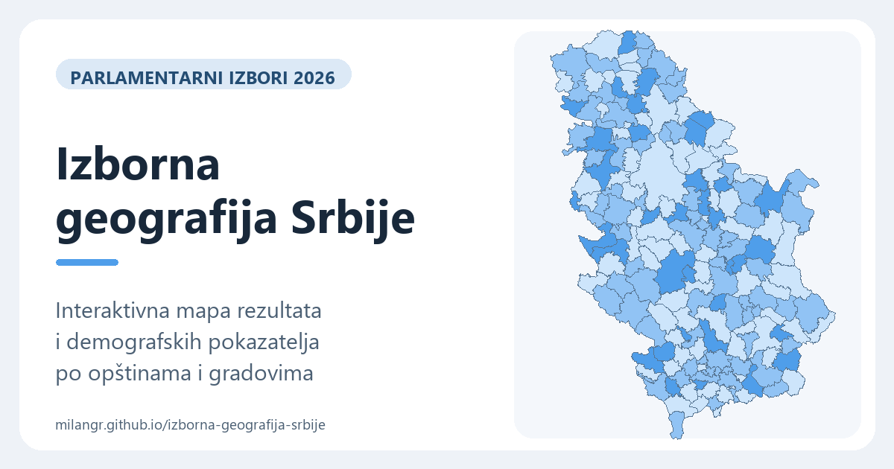

# Izborna geografija Srbije

**Interaktivni pregled parlamentarnih izbora 2026. po opštinama i gradovima Srbije.** Mapa, XY grafikon i tabela povezuju izborne rezultate s demografskim i socioekonomskim pokazateljima.

**[Otvori interaktivni prikaz](https://milangr.github.io/izborna-geografija-srbije/)**



## Šta se može istražiti

Početni prikaz: boja mape pokazuje razliku na 1000 izašlih, a gustina tačaka broj izašlih. XY poredi stepen razvijenosti (X) i razliku na 1000 izašlih (Y); veličina kruga predstavlja udio više/visoko obrazovanih, a boja regiju. Sve regije su uključene. Izabrani pokazatelji, regije i opcije povezivanja filtera pamte se lokalno u istom pregledniku. Trenutni filteri, odabrana opština i zum se ne čuvaju. Dugme „Vrati početni prikaz” briše sačuvane postavke i ponovo otvara puni početni prikaz bez filtera i zuma.

- **Mapa:** izaberi pokazatelje za boju opštine i gustinu tačaka, uvećaj prikaz i pogledaj vrijednosti za pojedinačnu opštinu. U donjem lijevom uglu mape prikazan je broj opština uključenih izborom regija i filtera. Izbor regija automatski prilagođava kadar mape njihovom zajedničkom obuhvatu. Klik na zaglavlje kolone ili oznaku reda označava pripadajuća polja matrice legende; izbor filtrira mapu, XY i regionalni box grafikon te tabelu kada je uključena opcija da tabela prati prikaze; Ctrl-klik dodaje ili uklanja pojedinačne izbore, a ikonica × čisti filter.
- **Pokazatelji uz mapu i XY:** mali box-and-whisker prikaz pokazuje raspodjelu vidljivih opština: brkovi dosežu minimum ili maksimum, ali ne prelaze granice Q1 - 1,5 × IQR i Q3 + 1,5 × IQR; kutija je Q1-Q3, tamna crta medijana, bijeli romb prosjek, a plavi trougao vrijednost odabrane opštine ili zbira. Male kružnice označavaju postojanje vrijednosti izvan brkova. Kod zbirnih brojeva, poput ukupnog broja izašlih, box u zbirnom prikazu ostaje na opštinskoj skali bez markera zbira; zbir je ispisan zasebno. Za udjele i stope zbirna vrijednost može biti označena na istoj skali. Prelazak mišem ili fokus na box prikazuje tabelu s Q1, medijanom, prosjekom, Q3 i prikazanom vrijednošću. Zbirna ili prosječna referenca ostaje u tekstu ispod.
- **XY grafikon:** uporedi opštine izborom X i Y ose te veličine i boje krugova. Izbor opštine povezan je s mapom. Desno od numeričke Y ose uspravni box plot prikazuje raspodjelu opština obuhvaćenih grafikonom: srednjih 50%, medijanu, rombom aritmetički prosjek opština i sivim brkovima ograničenim na 1,5 × IQR, bez posebnih zbirnih jedinica. Prati filtere, a pri zumiranju ostaje vezan za istu Y skalu.
- **Raspodjela po regijama:** box plot ima zasebne izbore Y mjere i X / veličine kruga u zaglavlju. Početno su izabrani razlika na 1000 izašlih (Y) i prosječna neto zarada u EUR (X / veličina kruga). Izbori se pamte u pregledniku i ne mijenjaju XY grafikon. Izbor regija kod mape ne filtrira regionalni box prikaz; on prikazuje sve regije, uz eventualno uključene filtere tabele. Za Y osu dostupne su numeričke mjere. Svaka regija ima vlastitu X osu, dok je skala veličine tačaka zajednička; gdje mjera nedostaje, tačke ostaju vidljive bez X vrijednosti. Kolona Ostalo prikazuje ukupne vrijednosti Inostranstva i kaznenih zavoda bez box plota; uključena je i u zbir svih regija. X osa svake regije prikazuje izabranu mjeru veličine kruga; izbor tačke povezan je s mapom i XY grafikonom. Kutija obuhvata srednju polovinu vrijednosti, crta označava medijanu, romb prosjek, a brkovi staju na minimumu/maksimumu ili granici 1,5 × IQR. Vrijednosti izvan brkova ostaju vidljive kao tačke. Zaglavlja koriste skraćene nazive regija te prikazuju medijanu i prosjek. Regije imaju zajedničku Y osu s uspravnim klizačem lijevo od nje; pomjeranje miša po grafikonu prikazuje vrijednost na osi, točkić zumira, a uvećani grafikon se može pomjerati povlačenjem. Referentna linija XY grafikona na X osi i oznake Med. uz male box prikaze na mapi i XY koriste klasičnu medijanu opština, uključujući Razliku na 1000 izašlih. Svaka opština ima jednaku težinu; posebne zbirne jedinice nisu uključene. Za Razliku na 1000 izašlih na X osi linija je uspravna; na Y osi nema linije medijane. Crta i romb u boxu ostaju medijana i aritmetički prosjek, uz jednaku težinu opština i bez posebnih zbirnih jedinica; zbirni pokazatelji i regionalni udjeli računaju se zasebno iz zbirnih podataka.
- **Vrijednosti na osama XY i regionalnog box grafikona:** prelazak mišem preko opštine prikazuje njene vrijednosti na X i Y osi. Klik zadržava izbor; poslije privremenog pregleda druge opštine oznake se vraćaju na klikom odabranu opštinu.
- **Tabela:** sortiraj i filtriraj rezultate po opštini, regiji, okrugu i dostupnim pokazateljima. Filteri i izbor redova se po želji primjenjuju na mapu, XY i box grafikon; box tada računa raspodjelu i ukupne vrijednosti samo za uključene jedinice. Opcija da tabela prati prikaze obuhvata izabrane regije, opštinu na mapi ili grafikonu i filter matrice legende.
- **Bočni pregled izbora:** kada je prozor širok najmanje 1880 px, desno se prikazuje tabela s pokazateljima u redovima i vrijednostima u drugoj koloni. Pet starosnih udjela ima horizontalne trake skalirane prema najbrojnijoj grupi u trenutnom izboru; broj pored trake je stvarni udio. Nazivi pokazatelja na prelazak mišem ili fokus prikazuju isti opis i izvore kao kolone glavne tabele. Prati vidljive kolone glavne tabele. Klikom odabrana jedinica prikazuje svoje podatke; bez pojedinačnog izbora koristi obračun zbirnog reda za regije i filtere mape i XY. Prelazak mišem ne mijenja ovaj pregled.
- **Preuzimanje:** na stranici je dostupan XLSX sa svim redovima i ukupnim zbirom.

Prikaz obuhvata **161 opštinu i grad** te **22 kosovske opštine s izbornim rezultatima**. Beograd je prikazan kroz 17 gradskih opština. Inostranstvo i zavodi za izvršenje sankcija prikazani su kao zasebni zbirni redovi, bez opštinske geometrije.

Za detaljno poređenje preporučuje se širi ekran. Stranica radi i na telefonu, uz zumiranje mape i grafikona te vodoravno pomjeranje tabele.

## Podaci i način računanja

**Razlika na 1000 izašlih** računa se kao `1000 × (glasovi Lista3 - glasovi Lista1) / broj izašlih birača`. Pozitivna vrijednost označava prednost Liste3, negativna prednost Liste1. Zbirni prikazi koriste zbir glasova i zbir izašlih, a ne prosjek opštinskih vrijednosti. Za nula izašlih ili nedostajuće ulazne podatke vrijednost nije dostupna. Mjera je u tabeli, XLSX preuzimanju i izborima pokazatelja na mapi, XY i box grafikonu.

Izborni rezultati potiču iz [konačnog izvještaja RIK-a](https://www.rik.parlament.gov.rs/vest/sr/822434/75-sednica-republicke-izborne-komisije.php) i [CSV-a po biračkim mjestima](https://www.rik.parlament.gov.rs/export-results/680072/2). Izbori su održani 25. oktobra 2026, a ponovljeno glasanje na 53 biračka mjesta 1. novembra. Udio liste predstavlja njen broj glasova podijeljen ukupnim brojem važećih glasova; izlaznost je broj birača koji su izašli podijeljen brojem upisanih birača.

Prosječna neto zarada RZS-a za 2025. po opštini izvorno je u RSD. Na stranici je prikazana približna vrijednost u EUR, dobijena dijeljenjem sa **117,2026 RSD/EUR**, prosječnim srednjim kursom za 2025. prema [NBS statističkom biltenu](https://www.nbs.rs/export/sites/NBS_site/documents-eng/publikacije/sb/sb_03_26.pdf). Na mapi razredi boje i gustine za zaradu imaju granice 750 i 850 EUR. XLSX preuzimanje zadržava izvorne RSD vrijednosti.

Demografski pokazatelji koriste [procjene stanovništva RZS-a za 2025](https://publikacije.stat.gov.rs/G2026/HtmlL/G20261178.html) i [Popis 2022](https://popis2022.stat.gov.rs/popisni-podaci-eksel-tabele/). Površine beogradskih opština dolaze iz [Statističkog godišnjaka RZS 2025](https://publikacije.stat.gov.rs/G2025/pdf/G20252058.pdf). Za ostale jedinice površina je izračunata iz pojednostavljenih granica. Podaci o visokom obrazovanju za opštine izvan Beograda preuzeti su od [Stanja Srbije](https://stanjesrbije.rs/pokazatelj/degree/) ([CC BY 4.0](https://creativecommons.org/licenses/by/4.0/)).

Pet udjela po starosti (0-14, 15-29, 30-44, 45-64 i 65+) izračunato je iz [RZS petogodišnjih razreda Popisa 2022](https://publikacije.stat.gov.rs/G2024/PdfE/G202413051.pdf). Imenilac je ukupno stanovništvo opštine iz istog popisa. Raspon 45-64 obuhvata 20 godina, ostale zatvorene grupe po 15, a 65+ je otvorena grupa. Broj stanovnika i gustina u zasebnim kolonama ostaju procjena za 2025.

Osnovne opštinske granice dolaze iz [geoBoundaries SRB ADM2](https://www.geoboundaries.org/api/current/gbOpen/SRB/ADM2/) ([tačna korištena verzija](https://github.com/wmgeolab/geoBoundaries/raw/9469f09/releaseData/gbOpen/SRB/ADM2/geoBoundaries-SRB-ADM2_simplified.geojson)). Izvorni podaci uključuju OpenStreetMap i Wambacher: © [OpenStreetMap contributors](https://www.openstreetmap.org/copyright), [ODbL 1.0](https://opendatacommons.org/licenses/odbl/1-0/). Unutrašnje granice Beograda i kosovskih opština izvedene su iz [RIK-ovih vektorskih slojeva](https://www.rik.parlament.gov.rs/542645/rezultati/); osnovni obris Kosova preuzet je iz [Eurostat GISCO NUTS 2024](https://gisco-services.ec.europa.eu/distribution/v2/nuts/nuts-2024-files.html) (© EuroGeographics © UN-FAO © Turkstat).

### Ograničenja prikaza

- Demografski podaci nisu uporedivo dostupni za 22 kosovske opštine. Sedam dodatnih kosovskih oblika nema izborni rezultat i na mapi ostaje sivo.
- Granice Beograda i kosovskih opština približno su poravnate s osnovnom mapom. Nisu pogodne za precizno mjerenje površine ili utvrđivanje administrativne granice.
- Za opštine izvan Beograda gustina stanovništva koristi površinu izvedenu iz pojednostavljenih geometrija; beogradske površine su službene i zaokružene na cijeli km².
- Zbirni pokazatelji računaju se iz pripadajućih ukupnih brojeva gdje je to moguće. Starosni udjeli u zbirnom prikazu računaju se iz broja stanovnika po razredima i ukupnog stanovništva Popisa 2022. za uključene opštine. Udio višeg/visokog obrazovanja ponderisan je brojem stanovnika 2025. u opštinama s dostupnim podatkom, kao približnom težinom za podatak iz Popisa 2022.

Dodatna objašnjenja pojedinačnih pokazatelja i izvora nalaze se u odjeljku **Izvori** na [stranici projekta](https://milangr.github.io/izborna-geografija-srbije/).

## Pokretanje i struktura repozitorija

Stranica je statična: otvori `index.html` u pregledniku ili posluži korijen repozitorija lokalnim HTTP serverom, na primjer `python -m http.server 8000`. Nije potreban korak izgradnje za prikaz stranice.

- `index.html` je ulazna stranica, a `assets/` sadrži stilove, aplikacijski kod, ikonu i naslovnu sliku.
- `assets/app.js` povezuje prikaze i upravlja njihovim zajedničkim izborom; `scatter.js` crta XY grafikon, a `region-bars.js` regionalni prikaz. `map-view.js` priprema geometriju mape i upravlja njenim zumiranjem i događajima; `table-view.js` iscrtava redove i zbir tabele. `map-legend.js` upravlja legendom, njenim filterom i bojama mape; `table-header.js` gradi zaglavlje tabele, filtere kolona, sortiranje i preslagivanje kolona.
- `assets/data-model.js` priprema objedinjene podatke i izvedene vrijednosti, a `metric-definitions.js` definiše pokazatelje, formatiranje, kolone i njihove izvore.
- `assets/selection-summary.js` prikazuje bočni pregled odabrane jedinice ili zbira na širokim ekranima.
- `assets/metric-readout.js` prikazuje vrijednosti i male box grafikone; `help-popovers.js` upravlja prozorima pomoći, a `view-preferences.js` učitava i čuva postavke prikaza.
- `assets/scatter-viewport.js` i `region-viewport.js` upravljaju zumiranjem i pomjeranjem grafikona, uključujući njihove kontrole raspona; moduli grafikona zadržavaju iscrtavanje i izbor opštine.
- `assets/filters.js` sadrži filtriranje i sortiranje bez zavisnosti od HTML-a; `choice-filter.js` prikazuje kontrolu za izbor vrijednosti, a `calculations.js` računa zbirove i statistiku raspodjele.
- `data/` sadrži podatke i geometrije koje stranica učitava te XLSX za preuzimanje.
- `sources/` čuva izvorne RIK, RZS i geografske datoteke korištene u pripremi.
- `scripts/` sadrži postupke za pripremu podataka, geometrija i XLSX datoteke.

Za razvojne provjere potrebni su Node.js 22+ i Python 3.10+ (`python` na PATH-u, ili varijabla `PYTHON`). Stranica i testovi ne zahtijevaju npm biblioteke niti korak izgradnje.

```sh
npm test                 # sintaksa, podaci, filteri, statistika i validacija izvoza
npm run test:browser     # interakcije u Chromeu/Chromiumu/Edgeu
npm run test:all         # sve prethodne provjere
```

Test preglednika sam pokreće lokalni server na slobodnom portu i zaseban privremeni profil. Ne koristi korisničke tabove ni sačuvane postavke. Ako preglednik nije pronađen, postavi `CHROME_PATH` na njegovu izvršnu datoteku. Na ograničenim sistemima proces preglednika mora imati dozvolu za pokretanje svojih pomoćnih procesa.

Za pomoćne skripte koje pripremaju granice i slike instaliraj provjerene verzije biblioteka u virtualno okruženje:

```sh
python -m venv .venv
# Aktiviraj .venv prema svom operativnom sistemu.
python -m pip install -r requirements.txt
```

Za XLSX je dodatno potreban privatni paket `@oai/artifact-tool` (provjereno s verzijom 2.8.148). Nije javna npm zavisnost. Koristi dostavljeni paket/runtime: instaliraj ga lokalno iz dobavljenog paketa ili postavi `ARTIFACT_NODE_MODULES` na njegov direktorij `node_modules`. U Codexu se lokacija može dobiti alatom za workspace dependencies. Bez tog paketa stranica i svi regresijski testovi i dalje rade; samo izvoz nije dostupan.

Nakon izmjene izvora za XLSX pokreni:

```sh
python scripts/build_socioeconomic_data.py
npm run build:xlsx
```

Generator izvodi raspone i formule iz broja redova; provjera očekivanog obuhvata od 185 jedinica ostaje odvojena u pripremi podataka. Za trenutni obuhvat provjerava svih 186 rezultata formula (185 jedinica i zbir) prije spremanja. Prikaz za provjeru nastaje u `outputs/export-preview.png`, a XLSX u `data/`. Komanda `python scripts/build_export_xlsx.py` ostaje kompatibilna prečica za isti JS generator; zajedničke definicije su u `scripts/export_schema.py`.


Za vlastiti kod projekta nije odabrana posebna licenca. Licence i atribucije izvora podataka i granica navedene su iznad i na stranici projekta.

Povezivanje tabele i prikaza bira se jednom kontrolom: „Bez povezivanja”, „Tabela → grafikoni” (filteri i izbor redova prenose se na mapu, XY i box) ili „Grafikoni → tabela” (tabela prati regije, legendu mape i odabranu opštinu).
